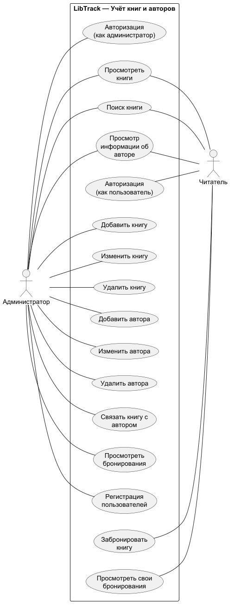
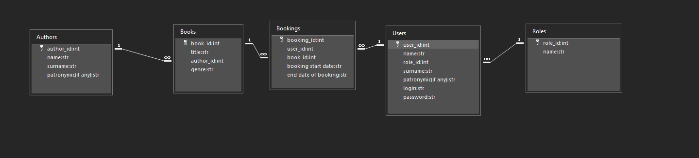

# Учет книг и авторов (литературный клуб)

## Цель работы

Изучить основные этапы создания информационной системы. Научиться описывать её задачи, пользователей и основные функции. Получить навыки создания Use Case диаграмм и блок-схем для наглядного представления работы системы.

## Практическая часть

## 1. Постановка задачи

### 1.1 Описание предметной области

Предметная область — литературный клуб, в котором нужно вести учёт книг и их авторов.  
Для этого создаётся информационная система «LibTrack».  
Пользователь может искать и бронировать книги, а администратор — добавлять, изменять и удалять данные.  
Система предназначена для хранения и обработки информации о книгах, авторах, пользователях и бронированиях.

### 1.2 Цели и задачи системы

- **Хранение информации о книгах:** Хранить сведения о книгах в системе.
- **Хранение информации об авторах:** Хранить сведения об авторах и связывать их с книгами.
- **Поиск книг:** Предоставить читателю возможность выполнять поиск книг.
- **Бронирование книг:** Предоставить читателю возможность создавать бронирования книг.
- **Управление данными**: Предоставить администратору возможность добавлять, изменять и удалять данные.

### 1.3 Пользователи системы (актеры) и их роли

1. **Администратор:** Управляет данными системы. Добавляет, изменяет и удаляет книги и авторов, связывает книги с авторами, просматривает бронирования, регистрирует администраторов и читателей.
2. **Читатель:** Работает с каталогом книг. Просматривает и ищет книги, просматривает свои бронирования, информацию об авторах и создаёт бронирования.

### 1.4 Основной функционал

- **Добавление новой книги** (ввод названия, автора и другой информации о книге).
- **Поиск книги** (поиск нужной книги в каталоге).
- **Просмотр информации о книге и авторе.**
- **Бронирование книги** (оформление бронирования выбранной книги).
- **Изменение и удаление данных** о книгах и авторах.
- **Просмотр своих бронирований**: Читатель может просматривать свои бронирования.
- **Просмотр бронирований**: Администратор может просматривать информацию о бронированиях.
- **Авторизация пользователя** (ввод имени и пароля пользователя).
- **Авторизация администратора** (ввод имени и пароля администратора).
- **Регистрация пользователей** (создание учётных записей администраторов и читателей администратором).

### 1.5 Архитектура проекта

Мы используем классическую трехуровневую архитектуру. Программа разделена на три независимых слоя:

1. **Слой интерфейса:** Консольный интерфейс, через который пользователь работает с системой. Программа выводит запросы, а пользователь вводит нужные данные.
2. **Слой бизнес-логики:** Основа программы. Отвечает за выполнение основных правил работы системы, обработку запросов пользователей, проверку данных и управление операциями с книгами, авторами и бронированиями.
3. **Слой данных:** База данных SQLite, в которой хранятся сведения о пользователях, ролях, книгах, авторах и бронированиях.

## Структура проекта

```text
Lab2_Project/
│
├── .venv/                         # Виртуальное окружение Python
├── docs/                          # Документация и диаграммы проекта
│   └── diagrams/                  # Диаграммы
│
├── out/                           # Файлы экспорта данных
│   ├── data.json
│   ├── data.csv
│   ├── data.xml
│   └── data.yaml
│
├── src/                           # Исходный код приложения
│   ├── database/                  # Работа с базой данных
│   │   └── database.py
│   │
│   ├── models/                     # Модели предметной области
│   │   ├── author.py
│   │   ├── book.py
│   │   ├── booking.py
│   │   ├── role.py
│   │   └── user.py
│   │
│   ├── repositories/              # Доступ к данным
│   │   ├── author_repository.py
│   │   ├── book_repository.py
│   │   ├── booking_repository.py
│   │   ├── role_repository.py
│   │   └── user_repository.py
│   │
│   ├── services/                  # Бизнес-логика приложения
│   │   ├── author_service.py
│   │   ├── book_service.py
│   │   ├── booking_service.py
│   │   └── user_service.py
│   │
│   ├── ui/                        # Пользовательский интерфейс
│   │   ├── auth.py
│   │   └── menu.py
│   │
│   ├── export_data.py             # Экспорт данных в JSON, CSV, XML и YAML
│   ├── main.py                    # Точка входа в приложение
│   ├── library.db                 # База данных SQLite
│   └── schema.sql                 # Схема таблиц базы данных
│
├── requirements.txt               # Список необходимых библиотек
├── .gitignore                     # Исключения для Git
└── README.md                      # Документация проекта
```
## Архитектура

Приложение построено с использованием многослойной архитектуры.

```text
Пользователь
      |
      v
Консольный интерфейс
(ui/auth.py, ui/menu.py)
      |
      v
Сервисный слой
(services)
      |
      v
Слой доступа к данным
(repositories)
      |
      v
База данных
(database)
```

## 2. Моделирование процессов и взаимодействий

### 2.1 Use Case диаграмма



## Запуск программы
Перейти в корневую папку проекта в терминале и вписать:

python src/main.py

### Эр-диаграмма базы данных «Учет книг и авторов»

